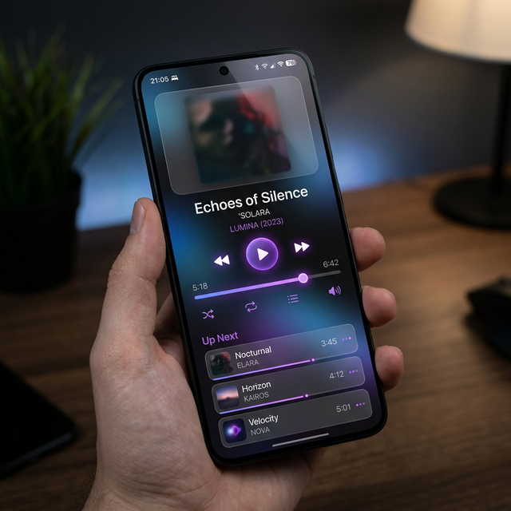

# SONAR – KI-gestützter Web-Music-Player

Webbasierter Musik-Player mit KI-generierten Playlists. Nutzer beschreiben eine Stimmung, die KI erstellt daraus eine Playlist, die Wiedergabe läuft über YouTube. Kein Abo, kein Nutzerkonto nötig.

Teamprojekt an der Kerschensteiner-Schule (BBS II) Delmenhorst, Lernfeld 8.



**Tech-Stack:** Next.js 16 · React 19 · TypeScript · Tailwind CSS 4 · GSAP · Framer Motion · Three.js · Groq API (Llama 3.3 70B) · YouTube Data API / IFrame API

## Funktionen

- **Web-Player** im Browser, ohne Installation
- **KI-Playlists** aus Stimmungs-Prompts (`/api/ai/generate`)
- **KI-Shuffle**, das eine bestehende Playlist neu ordnet (`/api/ai/shuffle`)
- **YouTube-Suche und -Wiedergabe** als kostenlose Audioquelle (`/api/yt`)
- **Landingpage** mit Animationen (GSAP, Framer Motion, Three.js)
- **Responsive** für Desktop und Mobilgeräte
- **Datenschutz:** Daten bleiben lokal im Browser (localStorage), kein Tracking

## Architektur

```
Browser (React-Frontend)
   │
   ├── /api/ai/generate  ──►  Groq API (Playlist aus Prompt)
   ├── /api/ai/shuffle   ──►  Groq API (Reihenfolge neu ordnen)
   └── /api/yt           ──►  YouTube Data API (Titel finden)
```

Der Groq-API-Key liegt nur serverseitig in den API-Routen und wird nicht an den Browser ausgeliefert.

## Lokal starten

1. Abhängigkeiten installieren:

   ```bash
   npm install
   ```

2. Datei `.env.local` anlegen (Vorlage: `.env.example`):

   ```bash
   GROQ_API_KEY=dein_groq_key
   NEXT_PUBLIC_YOUTUBE_API_KEY=dein_youtube_key
   ```

3. Entwicklungsserver starten und [http://localhost:3000](http://localhost:3000) öffnen:

   ```bash
   npm run dev
   ```

## Team

- **Joel Noah Janik** – Backend (API-Routen, KI- und YouTube-Anbindung)
- **Ilja** – Frontend (Landingpage, Web-Player, Animationen)
